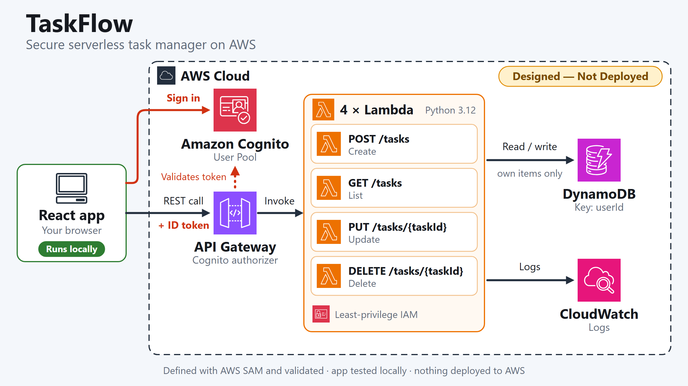
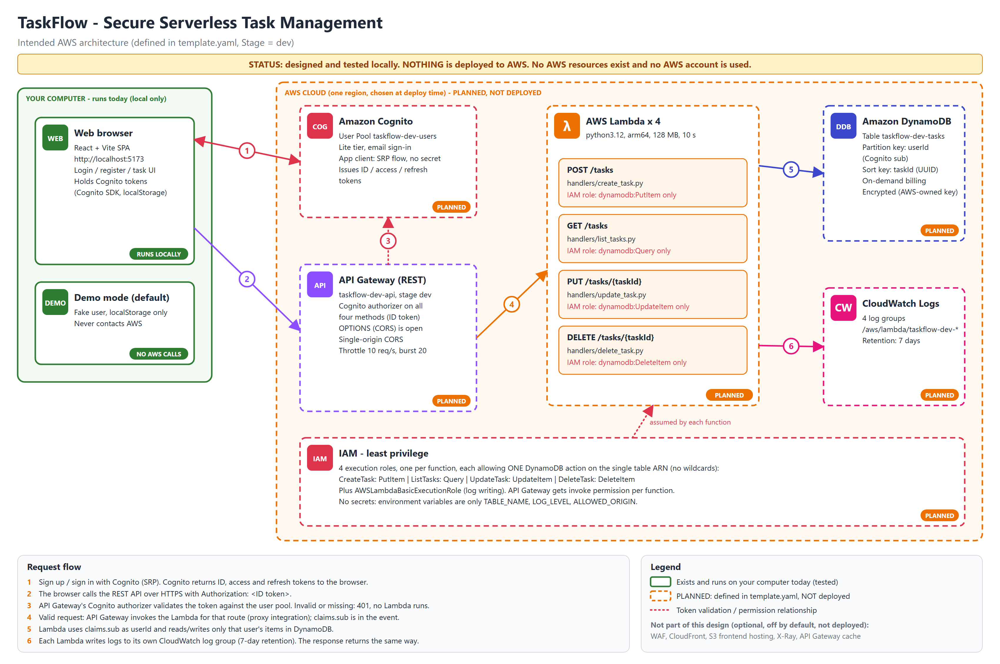
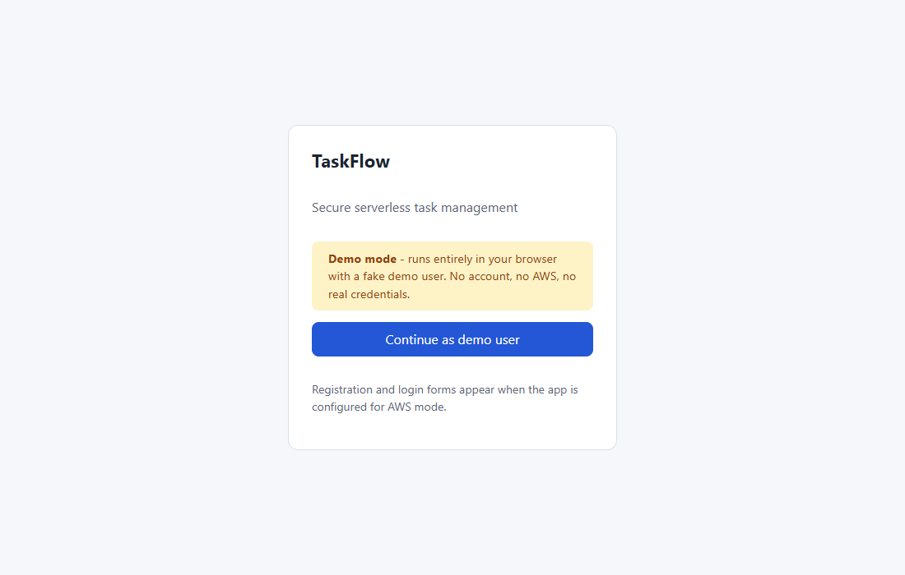
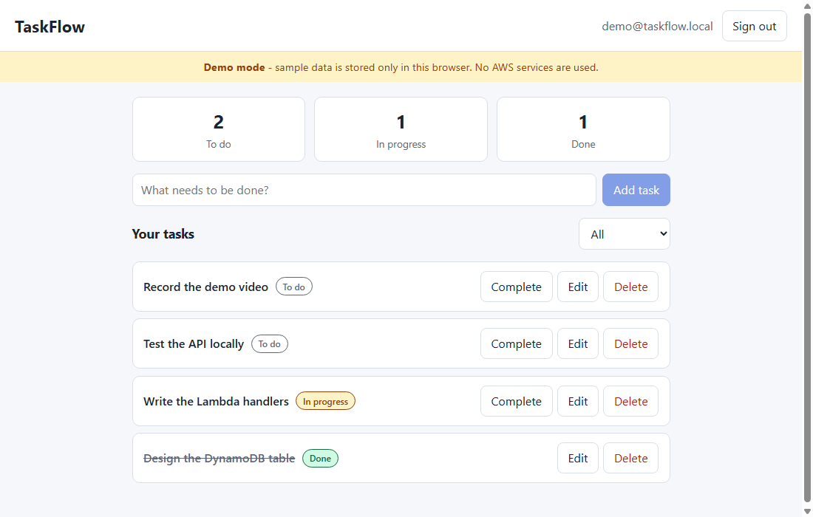
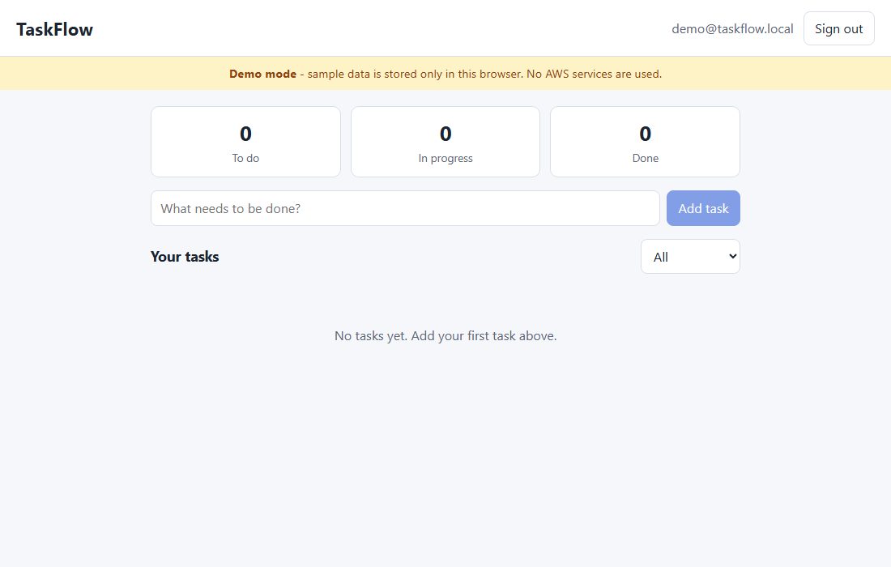
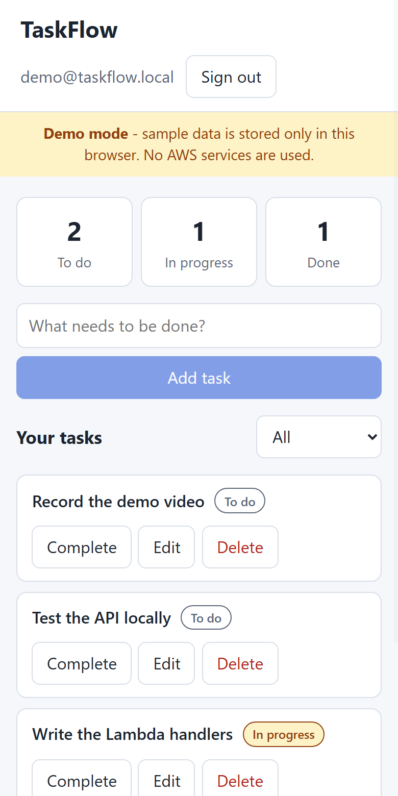

# TaskFlow - Secure Serverless Task Management on AWS


A To-Do web application that demonstrates a **secure, cost-conscious serverless architecture on AWS**: a React frontend, Amazon Cognito authentication, an API Gateway REST API, Python Lambda functions, DynamoDB and CloudWatch, defined as code with AWS SAM.

*Graduation project for the AWS Solutions Architect Associate programme (Manara).*

> ### Deployment status: NOT DEPLOYED
> | | |
> |---|---|
> | **Works today (runs locally)** | The React app in **demo mode**, the Python Lambda handlers (tested against a mocked DynamoDB), and the automated tests. No AWS account is needed. |
> | **Designed, NOT deployed** | The AWS infrastructure (Cognito, API Gateway, Lambda, DynamoDB, CloudWatch, IAM) is fully defined in [`template.yaml`](template.yaml) and validated with `sam validate --lint` and `sam build`, but **no AWS resources have been created** and no AWS credentials were used. |
> | **Not verified** | The frontend has never been run against a real Cognito user pool or API Gateway. |
>
> Deploying is optional and may incur charges in your own AWS account. See [Deploying to AWS](#deploying-to-aws-optional-not-executed).

## Table of Contents

1. [Solution Overview](#solution-overview)
2. [Architecture Diagram](#architecture-diagram)
3. [AWS Services and Design Decisions](#aws-services-and-design-decisions)
4. [Security](#security)
5. [Cost](#cost)
6. [Prerequisites](#prerequisites)
7. [Quick Start: Run the Local Demo](#quick-start-run-the-local-demo)
8. [Testing and Validation](#testing-and-validation)
9. [Deploying to AWS (optional, not executed)](#deploying-to-aws-optional-not-executed)
10. [Uninstall](#uninstall)
11. [API Reference](#api-reference)
12. [Screenshots](#screenshots)
13. [Repository Structure](#repository-structure)
14. [Documentation](#documentation)
15. [Limitations and Future Work](#limitations-and-future-work)
16. [License and Acknowledgements](#license-and-acknowledgements)

## Solution Overview

TaskFlow lets signed-in users **register, sign in, create, list, edit, complete and delete their own tasks**, with strict isolation between users. It is intentionally small so that the architecture, security and cost design can be reviewed end to end.

**Objectives**

- Design a three-tier serverless application using core Solutions Architect Associate services.
- Enforce **per-user data isolation** at every layer: Cognito identity, API authorizer, partition-key scoping and least-privilege IAM.
- Keep the design **cost-aware**: pay-per-use services only, optional paid components left out and documented.
- Treat infrastructure as code (AWS SAM) and prove correctness with automated tests that need no AWS account.

**What this repository contains**

| Part | Description |
|---|---|
| `frontend/` | React + Vite single-page app with a local **demo mode** (fake user, browser storage) and Cognito/API integration code for AWS mode |
| `backend/` | Four Python 3.12 Lambda handlers (create / list / update / delete) and 74 pytest tests using a mocked DynamoDB |
| `template.yaml` | AWS SAM template describing the AWS infrastructure (**not deployed**) |
| `docs/` | Architecture diagrams, security and cost review, optional deployment and teardown guide, screenshots, submission summary |

## Architecture Diagram

**Overview** (official AWS Architecture Icons). The AWS group is dashed because it is **designed, not deployed**; the React app runs on your own computer, not on AWS.

[](docs/linkedin/taskflow-architecture-linkedin.png)

**Detailed view** with request flow, IAM and the local demo mode (editable source: [`docs/architecture.drawio`](docs/architecture.drawio), open with [diagrams.net](https://app.diagrams.net)):

[](docs/architecture.png)

### Request flow

| Step | What happens |
|---|---|
| 1 | The browser signs up or signs in with Cognito (SRP: the password is never sent in clear). Cognito returns ID, access and refresh tokens. |
| 2 | The browser calls `https://<api>/<stage>/tasks...` with `Authorization: <ID token>`. |
| 3 | API Gateway's Cognito authorizer validates the token against the user pool. Missing or invalid token: `401`, and no Lambda is invoked. |
| 4 | For a valid token, API Gateway invokes the Lambda for the route: `POST /tasks`, `GET /tasks`, `PUT /tasks/{taskId}`, `DELETE /tasks/{taskId}`. The verified claims, including `sub`, arrive in the event. |
| 5 | The Lambda takes `userId` from `claims.sub` (never from the request body or query string) and reads or writes only items with that partition key. |
| 6 | The Lambda writes logs to its own CloudWatch log group and returns JSON; the response travels back the same way. |

**Demo mode** (the default, works today): the browser uses a fake local user and `localStorage` instead of steps 1-6. Its code path contains no URL, token or AWS SDK call, so it cannot reach AWS.

## AWS Services and Design Decisions

All rows are **designed, not deployed** and defined in [`template.yaml`](template.yaml) (22 CloudFormation resources after SAM expansion).

| Service | Template resource(s) | Role in TaskFlow | Key settings |
|---|---|---|---|
| Amazon Cognito | `UserPool`, `UserPoolClient` | Registration, sign-in, JWT issuance | Lite tier, email sign-in, SRP + refresh flows only, no client secret |
| Amazon API Gateway (REST API) | `TaskApi` | HTTPS endpoint, Cognito authorizer, CORS, throttling | Authorizer on all 4 methods; 10 req/s, burst 20; single-origin CORS |
| AWS Lambda | `Create/List/Update/DeleteTaskFunction` | One CRUD function per route | Python 3.12, arm64, 128 MB, 10 s timeout |
| Amazon DynamoDB | `TasksTable` | Task storage | On-demand; partition key `userId`, sort key `taskId`; AWS-owned-key encryption |
| Amazon CloudWatch Logs | 4 `*LogGroup` resources | Function logs | Retention 7 days (parameter `LogRetentionDays`) |
| AWS IAM | One role per function (created by SAM) | Least privilege | One DynamoDB action each, on the single table ARN |

**Design decisions**

| Decision | Reason |
|---|---|
| REST API with a Cognito User Pool authorizer | Native token validation before any code runs, plus per-method throttling. An HTTP API with a JWT authorizer would be cheaper; REST was chosen to show the Cognito authorizer integration. |
| DynamoDB on-demand, key `userId` + `taskId` | No idle cost; `Query` on `userId` returns exactly one user's tasks, so isolation and access pattern coincide. |
| One Lambda per route, one IAM action each | Least privilege and simple blast radius. |
| `userId` from the verified `sub` claim only | Client-supplied identity is never trusted. |
| Lambda arm64, 128 MB; Cognito Lite; no KMS key; 7-day logs | Lowest-cost settings that fit the workload. |
| AWS SAM | Concise infrastructure as code that can be validated and built locally without an AWS account. |

**Left out on purpose** (documented as optional extensions, not part of the design): AWS WAF, Amazon CloudFront and S3 frontend hosting, AWS X-Ray, API Gateway caching.

## Security

Defence in depth, layer by layer (defined in `template.yaml` and the backend code, and verified by tests where possible):

| Layer | Control |
|---|---|
| Identity | Cognito User Pool, SRP sign-in only, no client secret in the SPA, user-existence errors hidden, token revocation enabled. |
| Edge | HTTPS only (API Gateway); Cognito authorizer on all four methods (only the CORS preflight `OPTIONS` is open); throttling of 10 req/s with burst 20; single-origin CORS, wildcards rejected by the template. |
| Authorisation | `userId` always comes from the verified JWT `sub`; a `userId` in the body or query string is ignored. The DynamoDB partition key is `userId`, and update/delete use a condition on the existing item, so another user's task returns `404` (existence is not leaked). Covered by cross-user tests. |
| Input | Titles 1-200 characters, status limited to `todo` / `in_progress` / `done`, UUID task ids, JSON object bodies under 10 KB. |
| Errors | Controlled messages only; unexpected errors return a generic `500` and are logged to CloudWatch, never returned to the client. |
| IAM | One execution role per function with a single DynamoDB action (`PutItem`, `Query`, `UpdateItem`, `DeleteItem`) on the single table ARN. No wildcard resources. |
| Data | Encrypted at rest (DynamoDB AWS-owned key). No secrets in environment variables (`TABLE_NAME`, `LOG_LEVEL`, `ALLOWED_ORIGIN` only) or in the repository; frontend configuration holds public identifiers only. |
| Logging | Explicit CloudWatch log groups with finite retention. |

**Residual risks:** the API URL is public, the password policy is basic (8+ characters, no MFA), there is no WAF (deliberately), no backups (PITR off), and the Cognito SDK keeps tokens in browser storage. The full review is in [docs/cost-and-readiness.md](docs/cost-and-readiness.md). This is an educational project; do not store real personal data in a deployed demo.

## Cost

Everything is pay-per-use, so an idle deployment costs approximately nothing. These are **estimates, not guarantees**.

| Item | Detail |
|---|---|
| Estimated demo cost | About 2,000 requests per month, 5 users: roughly **$0.01-$0.05 per month at list price, before any Free Tier or credits** |
| Free Tier | **Not assumed.** Eligibility depends on when your AWS account was created and which plan it is on. Check *Billing → Free Tier* |
| Cost controls in the template | 7-day log retention, arm64 / 128 MB Lambda, Cognito Lite tier, DynamoDB without KMS charges, API throttling, paid options off |
| Main risks | A public API URL (throttle caps it at 10 req/s), forgetting to delete the stack, enabling WAF / CloudFront / X-Ray / API cache later |

Before deploying: create an **AWS Budget alert**, and delete the stack after the demo. Pricing notes, assumptions and risks: [docs/cost-and-readiness.md](docs/cost-and-readiness.md).

## Prerequisites

| Need | For | Notes |
|---|---|---|
| **Node.js 22 LTS** (22.22.2 or later) with npm | Frontend and its tests | The test tooling (Vitest 5, jsdom 30) requires Node 22.12+ / 22.22.2+; Node 20.19+ is enough for `npm run dev` / `build` only |
| **Python 3.12** | Backend tests, `sam build` | Matches the Lambda runtime |
| AWS SAM CLI | `sam validate`, `sam build` | Installed by `pip install -r requirements.txt` |
| Git | Cloning | |
| AWS account + AWS CLI | **Only** for the optional deployment | Not needed for the demo, tests or validation |

Commands below use Windows PowerShell; on macOS/Linux activate the virtual environment with `source .venv/bin/activate`.

## Quick Start: Run the Local Demo

No AWS account, credentials or cloud services are needed.

```powershell
git clone https://github.com/Mariemba4/TaskFlow-AWS.git
cd TaskFlow-AWS\frontend
npm install
npm run dev          # open http://localhost:5173
```

Click **Continue as demo user**, then add, edit, complete and delete tasks. Demo mode is the default when `frontend/.env.local` does not exist. Tasks are stored in your browser's `localStorage` under the `taskflow-demo:` prefix, the demo user is fake (`demo@taskflow.local`), and a "Demo mode" banner is always visible.

**Switching to AWS mode** (only after you have deployed the stack yourself): copy `frontend/.env.example` to `frontend/.env.local` (git-ignored) and set `VITE_DEMO_MODE=false` plus `VITE_API_URL`, `VITE_COGNITO_USER_POOL_ID`, `VITE_COGNITO_CLIENT_ID` and `VITE_AWS_REGION` from the stack outputs. If AWS mode is on and a variable is missing, the app shows a configuration error. It never falls back silently to demo mode, and demo mode never falls back to AWS. `FrontendOrigin` in the stack must match your frontend URL for CORS.

## Testing and Validation

Everything here runs locally and needs **no AWS account or credentials**: DynamoDB is mocked with moto and dummy credentials are forced in the test setup.

```powershell
# Backend and template (from the repository root)
python -m venv .venv
.\.venv\Scripts\Activate.ps1
pip install -r requirements.txt
python -m pytest backend/tests -q        # 74 passed
sam validate --lint                      # valid SAM template
sam build                                # Build Succeeded

# Frontend
cd frontend
npm install
npm test                                 # 25 passed
npm run build                            # production build
npm audit                                # 0 vulnerabilities
```

| Suite | What it covers |
|---|---|
| Backend (74 tests) | CRUD, invalid and boundary input, malformed bodies and task ids, missing or malformed auth claims, cross-user isolation, nonexistent tasks, error-message hygiene |
| Frontend (25 tests) | API client (headers, 401/404/500 handling, no token logging), demo store, mode selection (demo never calls `fetch`), UI flows |
| Template | `sam validate --lint`, `sam build` |

## Deploying to AWS (optional, not executed)

> **These steps have not been run.** Deploying creates resources in your own AWS account and **may incur charges**. Read [docs/cost-and-readiness.md](docs/cost-and-readiness.md) first, set an AWS Budget alert, and use your own credentials (never commit them).

The reviewed, step-by-step procedure (credentials, `sam deploy`, outputs, smoke tests, teardown) is in [docs/deployment.md](docs/deployment.md). In outline:

```powershell
sam build
sam deploy --stack-name taskflow-dev --region <region> --resolve-s3 --capabilities CAPABILITY_IAM --confirm-changeset `
  --parameter-overrides Stage=dev FrontendOrigin=http://localhost:5173 LogRetentionDays=7
```

**Template parameters**

| Parameter | Default | Purpose |
|---|---|---|
| `Stage` | `dev` | Stage name (`dev` or `prod`) used in resource names |
| `FrontendOrigin` | `http://localhost:5173` | The single allowed CORS origin (wildcards rejected) |
| `LogRetentionDays` | `7` | CloudWatch log retention (1-90 days) |
| `EnableXRay` | `false` | Optional tracing (may incur cost) |
| `EnableApiCache` | `false` | Optional API cache (not Free Tier eligible) |

**Stack outputs:** `ApiUrl`, `UserPoolId`, `UserPoolClientId`, `TableName`.

## Uninstall

Nothing is deployed by default, so there is nothing to remove. If you deploy, delete everything with:

```powershell
sam delete --stack-name taskflow-dev --region <region>
```

This removes the Cognito pool and its users, the DynamoDB table and its data, the API, Lambdas, roles and log groups. [docs/deployment.md](docs/deployment.md) also covers verifying the deletion and removing the SAM-managed artifact bucket.

## API Reference

All endpoints require `Authorization: <Cognito ID token>`. The caller's identity is always the token's `sub` claim.

| Method | Path | Description | Success |
|---|---|---|---|
| POST | `/tasks` | Create a task | `201` + task |
| GET | `/tasks` | List my tasks (newest first) | `200` `{"tasks": [...]}` |
| PUT | `/tasks/{taskId}` | Update `title` and/or `status` | `200` + task |
| DELETE | `/tasks/{taskId}` | Delete a task | `204` |

**Task:** `{ userId, taskId (UUID), title (1-200 chars), status: todo | in_progress | done, createdAt, updatedAt }` (UTC ISO-8601).

**Errors:** `400` invalid input or malformed JSON / taskId, `401` missing identity, `404` task not found *or owned by someone else*, `500` generic message (details only in CloudWatch).

Example requests (these work only after a deployment; replace the placeholders):

```bash
API=https://<api-id>.execute-api.<region>.amazonaws.com/dev
TOKEN=<cognito-id-token>

curl -X POST $API/tasks -H "Authorization: $TOKEN" -H "Content-Type: application/json" -d '{"title": "Write report"}'
curl $API/tasks -H "Authorization: $TOKEN"
curl -X PUT $API/tasks/<taskId> -H "Authorization: $TOKEN" -H "Content-Type: application/json" -d '{"status": "done"}'
curl -X DELETE $API/tasks/<taskId> -H "Authorization: $TOKEN"
```

## Screenshots

Captured from the production build of the frontend running locally in **demo mode** (generic sample data, no AWS). There are no AWS console screenshots because nothing is deployed.

| Demo entry | Dashboard with tasks |
|---|---|
|  |  |

| Empty state | Mobile layout |
|---|---|
|  |  |

## Repository Structure

```
TaskFlow-AWS/
├── README.md
├── LICENSE                    # MIT
├── template.yaml              # AWS SAM template (22 resources, not deployed)
├── requirements.txt           # Local dev/test tooling (SAM CLI, boto3, pytest, moto)
├── backend/
│   ├── src/
│   │   ├── handlers/          # create_task, list_tasks, update_task, delete_task
│   │   ├── common/            # auth, db, http (error handling), responses, validation
│   │   └── requirements.txt   # Lambda runtime dependencies (none needed)
│   └── tests/                 # pytest + moto
├── frontend/
│   ├── src/
│   │   ├── config.js          # env parsing, demo vs AWS selection
│   │   ├── services/          # apiClient, cognitoAuth, demo store (no React)
│   │   ├── hooks/             # useTasks
│   │   ├── components/        # AuthPage, Dashboard, TaskItem, StatusBadge, Alert
│   │   └── test/              # test setup
│   ├── .env.example           # public configuration template (no secrets)
│   └── package.json
└── docs/
    ├── architecture.drawio    # editable detailed diagram
    ├── architecture.png       # detailed diagram
    ├── linkedin/              # overview diagram with official AWS icons (png + drawio)
    ├── cost-and-readiness.md  # resources, cost estimate, security review
    ├── deployment.md          # optional deploy + teardown procedure (not executed)
    ├── submission.md          # summary for the Manara submission
    └── screenshots/           # local demo screenshots
```

## Documentation

| Document | Contents |
|---|---|
| [docs/submission.md](docs/submission.md) | Concise summary: what is implemented, what is planned, how to verify |
| [docs/cost-and-readiness.md](docs/cost-and-readiness.md) | Resource list, cost estimate with assumptions, security findings |
| [docs/deployment.md](docs/deployment.md) | Optional deployment and full teardown (not executed) |
| [docs/architecture.drawio](docs/architecture.drawio) | Editable detailed architecture diagram |
| [docs/linkedin/taskflow-architecture-linkedin.drawio](docs/linkedin/taskflow-architecture-linkedin.drawio) | Editable overview diagram |

## Limitations and Future Work

- Not deployed; the frontend has never been exercised against real Cognito or API Gateway, only against mocks.
- Real-world behaviour of a deployed stack (CORS, email verification, latency, actual cost) is unverified.
- Possible extensions, none implemented or deployed: S3 + CloudFront hosting, WAF, X-Ray, API caching, MFA, DynamoDB backups, a CI pipeline.

## License and Acknowledgements

Released under the [MIT License](LICENSE). This is an educational graduation project by Mariem Benabid ([@Mariemba4](https://github.com/Mariemba4)).

Architecture icons are from the [AWS Architecture Icons](https://aws.amazon.com/architecture/icons/) package, used unmodified. AWS and the AWS service names are trademarks of Amazon.com, Inc. or its affiliates; this project is not affiliated with or endorsed by AWS.
